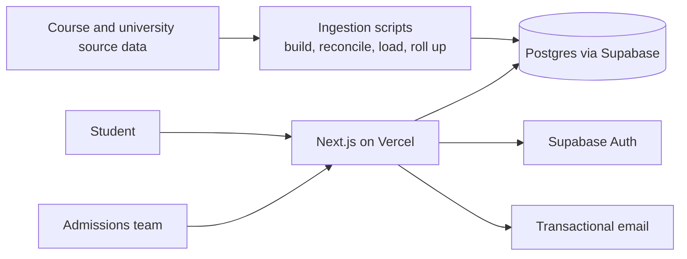

# Apply24x7: UK University Admissions Platform

> **Architecture case study.** Source code is private and owned by the client. This repository contains original documentation only: no client code, data, credentials or assets.

## Architecture

## Problem

Students in Bangladesh applying to UK universities face scattered course information and a slow, manual application process run through counsellors.

## Solution

A searchable catalogue of universities and courses, built through a repeatable data ingestion pipeline, connected to an online application flow and an admin back office.

## Modules

- **Catalogue**: universities, courses, subjects, search
- **Applications**: student profile, course choice, document submission
- **Back office**: application review, status updates
- **Ingestion**: build, reconcile and load university and course data
- **Notifications**: transactional email

## Tech stack

- Next.js 15, React, TypeScript
- Supabase (Postgres, Auth)
- Vercel hosting and analytics
- React Hook Form + Zod
- Transactional email via Resend
- TypeScript ingestion scripts

## Key design decisions

1. Course data is loaded through scripted ingestion and reconciliation steps, so the catalogue can be rebuilt and refreshed rather than hand-edited.
2. Subjects are rolled up per university to make browsing fast and consistent.
3. Forms share one validation schema between client and server.
4. Content and admin seeding are scripted, making environments reproducible.

---

Designed and delivered by [Adil Ahmed](https://github.com/AdilAhmedAhir) at [Start Daily xyz Limited](https://startdaily.xyz), Dhaka.
